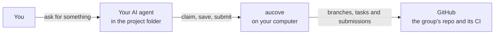
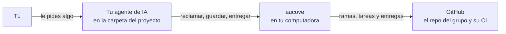

<p align="center">
  
</p>

<h1 align="center">aucove</h1>

<p align="center">
  <b>Verifiable collaborative authorship</b> for research teams that work with AI.<br>
  <i>Autoría colaborativa verificable para equipos de investigación que trabajan con IA.</i>
</p>

<p align="center">
  <a href="https://pypi.org/project/aucove/"></a>
  <a href="https://github.com/aucove/aucove/actions/workflows/ci.yml"></a>
  
  <a href="LICENSE"></a>
  <a href="spec/"></a>
</p>

<p align="center"><a href="#english">English</a> · <a href="#español">Español</a></p>

## English

### Why aucove

AI models and agents are changing the way research is done. In many groups, each person already works with an assistant that searches the literature, discusses ideas, drafts text and runs analyses, and several people do so at the same time on the same project. aucove is a proposal for bringing AI models into collaborative research the way it already happens: each person works with their own agent on a shared repository, and the group keeps clear rules about who does what, who reviews it and what goes into the shared version.

When AI writes part of the text or the code, authorship has to come first. It matters who proposed an idea, who did the work, who reviewed it and when, and the group must be able to show it without relying on memory or goodwill. aucove gathers that evidence while the work happens:

- each submission and each merge is sealed with a verifiable timestamp;
- with the project signature, a key that the group publishes proves that each record comes from the project;
- the project history is versioned, in a private repository that opens at milestones or in a public one from day one;
- every save declares which AI tool and model were used;
- at each milestone, the group safeguards the evidence outside GitHub, for example as an encrypted registration on OSF, and can publish the work with a DOI on Zenodo.

With that record, authorship conflicts can be prevented, or settled with evidence.

aucove grew out of that need. It is open source, anyone who wants to collaborate is welcome, and we hope it is useful in your projects.

### What it is

*aucove* is an open source framework for research teams that work in parallel on a shared GitHub repository, each person with the AI agent of their choice, such as Antigravity CLI, Claude Code, Codex, Cursor, Gemini CLI, GitHub Copilot, goose or OpenCode. Each person is in charge of parts of the work and takes tasks without clashing with others, and someone else reviews and approves each submission. CI validates every submission, builds the PDF when the project uses LaTeX and seals it with a verifiable timestamp, so everyone can prove their contribution without publishing early.

The name comes from the Spanish **AU**toría **CO**laborativa **VE**rificable (verifiable collaborative authorship), and it is pronounced *AW-kove*.

### How it works

1. **Task.** A concrete piece of work on your parts, such as the methods, a chapter or an experiment. You claim it so nobody else takes it.
2. **Submission.** Your work ready for review, with a note on what you did. CI checks it and seals it.
3. **Approval.** Someone else reviews it and merges it into the shared version.



Your agent opens in the project folder, a clone of the group's repository, and calls aucove for the mechanical work. Whatever the agent runs, such as an analysis, a training run or the PDF build, runs on your computer. A cloud session, such as Claude Code on the web (claude.ai/code), is an option when you do not want to install anything. More in [How it works](docs/en/how-it-works.md).

### What sets it apart

- **Verifiable timestamps and origin.** Every submission is sealed with OpenTimestamps, and every merge also with two RFC 3161 timestamps. With the project signature, a key that the group publishes also proves that the project issued each record. The repository can stay private, and anyone can verify a seal later, even without aucove.
- **Parts with owners.** Each part has a person in charge. The agent does not touch other people's parts, and if something slips through, CI stops it before it reaches the shared version.
- **AI as a declared assistant.** The agent searches the literature, discusses ideas, writes and runs code. Every save records the tool and the model used, and approving is still up to people.
- **With the agent of your choice, or none.** Every agent follows the same rules (`AGENTS.md`) and goes through the same CI. Claude Code and Codex get the full integration from `0.1.0` (skills, MCP server and hooks). Any other agent that reads `AGENTS.md` and can run commands, such as Antigravity CLI, Cursor, Gemini CLI, GitHub Copilot, goose or OpenCode, works with the rules, the shared context and the CLI, and CI stops its mistakes. You can also work without AI, with the CLI.
- **Data stays where it belongs.** Raw data never enters the repository, and the lead sets what the AI may see depending on how sensitive the data is.
- **LaTeX is optional.** With LaTeX, CI builds the PDF of every submission; without it, the project works in Markdown.

### Initial setup

Each person does this once, in this order: first GitHub, then your computer and finally your agent. Each step says who does it:

| Step | Lead: creates the project and administers the organization | Researcher: joins a project |
|---|---|---|
| [1. Your account and private email](#1-your-github-account-and-private-email) | Yes | Yes |
| [2. The organization and the repo](#2-the-organization-and-the-empty-repo) | Creates them | Accepts the invitation |
| [3. git and your identity](#3-git-and-your-identity) | Yes | Yes |
| [4. aucove](#4-install-aucove) | Yes | Yes |
| [5. Your GitHub token](#5-create-your-github-token) | Yes | Yes |
| [6. The token in `GH_TOKEN`](#6-store-the-token-in-gh_token) | Yes | Yes |
| [7. The project on your computer](#7-the-project-on-your-computer) | Creates it with `aucove init --repo` | Clones it |
| [8. Your agent](#8-open-your-agent-in-the-project) | Yes | Yes |

The deputy and the article editor set up as researchers. If you will only work from the browser (claude.ai/code), steps 1 and 2 are enough ([Researcher](docs/en/researcher.md#before-the-first-day)). If you would rather have your agent with you at every step, use [Setting up aucove with your agent](docs/en/setup-with-your-agent.md), which has the messages you paste to it.

#### 1. Your GitHub account and private email

If you do not have an account, create one at [github.com/signup](https://github.com/signup). Then:

1. On GitHub, click your photo, at the top right, and go to **Settings** → **Emails**.
2. Check **Keep my email addresses private**.
3. Copy the address shown on that page, of the form `<number>+<your-username>@users.noreply.github.com`. You use it in step 3, so that your personal email does not end up in the project history.

#### 2. The organization and the empty repo

**Researcher:** accept the invitation to the organization that GitHub emails you and go on to step 3.

**Lead:** you create the group's space and the project repo, in this order.

1. **The organization.** Click your photo → **Your organizations** → **New organization**, choose the plan, give it a name, for example `labfe`, and complete the form.
2. **Your team.** In the organization, go to **People** → **Invite member** and type each person's GitHub username. You can do it now or when you finish.
3. **The empty repo.** In the organization, go to **Repositories** → **New repository**. Type the name, for example `ising-diluido`, and choose **Private**. Do not add a README, a `.gitignore` or a license, and click **Create repository**. It must stay empty: in step 7, `aucove init --repo` pushes the whole project to it.

> [!NOTE]
> On a private repo, GitHub only enforces the project's rules with the Team plan, which is free for teachers and researchers through [GitHub Education](https://education.github.com/): you request it from its dashboard ("Upgrade your academic organizations"), not from the billing page. With the Free plan, a private repo works, but GitHub blocks nothing: anyone can merge without approval and red checks only warn. A public repo gets the full rules with the Free plan.

#### 3. git and your identity

1. Install git. On Windows, with the installer from [git-scm.com](https://git-scm.com/downloads) and its default options, which include the credential manager that remembers your GitHub sign-in. On macOS, with `xcode-select --install`; on Linux, with your system's package manager.
2. Open a new terminal (PowerShell on Windows, Terminal on macOS) and tell git who you are, with your name and the `noreply` address from step 1:

   ```bash
   git config --global user.name "Your Name"
   git config --global user.email "<number>+<your-username>@users.noreply.github.com"
   ```

   git puts that name and email in every commit. To check, `git config --global user.email` must show the `noreply` address.

#### 4. Install aucove

> [!IMPORTANT]
> Install and update aucove only from a terminal opened from the Start menu (or Terminal on macOS), never from inside your agent's app. On Windows, whatever is installed from inside Claude Desktop, by the agent or from its Terminal panel, stays in a private copy that only that app sees and that hides the one you install outside.

Install it once per computer, in two parts: first [uv](https://docs.astral.sh/uv/), the tool that installs it, and then aucove itself, in its exact version and with the dependencies pinned in the `requirements-lock.txt` of its Release (01-arquitectura §5.1).

**1. uv.** Skip this part if `uv --version` already works in your terminal.

On Windows, in PowerShell 5.1 or 7:

```powershell
powershell -ExecutionPolicy ByPass -c "irm https://astral.sh/uv/install.ps1 | iex"
```

On macOS or Linux, in bash or zsh:

```bash
curl -LsSf https://astral.sh/uv/install.sh | sh
```

If your institution blocks these scripts, use `winget install --id=astral-sh.uv -e` on Windows or `brew install uv` on macOS. **Then close the terminal and open a new one**, so that it finds the `uv` command.

**2. aucove**, in the new terminal.

On Windows, in PowerShell:

```powershell
$lock = New-TemporaryFile
Invoke-WebRequest -UseBasicParsing https://github.com/aucove/aucove/releases/download/v0.1.0rc3/requirements-lock.txt -OutFile $lock.FullName
$env:UV_COMPILE_BYTECODE = "1"; uv tool install "aucove==0.1.0rc3" --constraints $lock.FullName
uv tool update-shell
```

On macOS or Linux, in bash or zsh:

```bash
LOCK="$(mktemp)"
curl -fsSL -o "$LOCK" https://github.com/aucove/aucove/releases/download/v0.1.0rc3/requirements-lock.txt
UV_COMPILE_BYTECODE=1 uv tool install "aucove==0.1.0rc3" --constraints "$LOCK"
uv tool update-shell
```

Close the terminal, open a new one and check with `aucove --version`: it must show the version in these commands. If your agent was already open, close it and open it again; quit Claude Desktop from its icon in the system tray, not just its window. If your agent sees a different version than your terminal, see [If something fails](docs/en/when-something-happens.md#if-something-fails).

To verify evidence seals on your computer (`aucove evidence verify`), install it with the `evidence` extra: in the `uv tool install` command, write `"aucove[evidence]==0.1.0rc3"`. If aucove is already installed, the same command adds the extra. CI seals every submission without it.

#### 5. Create your GitHub token

It is the key aucove uses to work on GitHub on your behalf: it creates your task branch, saves your work and opens your submission. It only works on the project repo, with just the permissions it needs, and it expires in 30 days.

1. Open this link, which fills in the GitHub form with those permissions. First replace `<org>` and `<repo>` with those of your project, for example `labfe` and `ising-diluido`:

   ```text
   https://github.com/settings/personal-access-tokens/new?name=aucove-<repo>&description=aucove+(<repo>)&target_name=<org>&expires_in=30&contents=write&issues=write&pull_requests=write&actions=read&statuses=read
   ```

2. Check that **Resource owner** is the project's organization.
3. Under **Repository access**, choose **Only select repositories** and check the project repo. It is the only thing the link cannot choose for you.
4. The permissions must be **Contents**, **Issues** and **Pull requests** on "Read and write", and **Actions**, **Commit statuses** and **Metadata** on "Read-only". Do not add any other.
5. Click **Generate token** and copy the token, which starts with `github_pat_`. Keep it in your password manager: GitHub will not show it again.

If you are a researcher and the organization requires approving tokens, the usual case, yours stays pending until the lead approves it. The organization owner's tokens need no approval.

> [!WARNING]
> Never paste the token into the chat with your agent or into a project file. If it leaks, delete it on GitHub (your photo → **Settings** → **Developer settings** → **Personal access tokens** → **Fine-grained tokens**) and create another. Your agent runs with your permissions and could in principle read it: that is why the token is limited to a single repo and has no administration permissions. If you do not want it on your computer, work from the browser (claude.ai/code), where you do not need it.

#### 6. Store the token in `GH_TOKEN`

aucove looks for your token in the `GH_TOKEN` environment variable. Store it with your system's command, in a terminal opened from the Start menu (or Terminal on macOS). The command asks you to paste the token, which is not shown as you paste it and does not stay in the history.

On Windows, in PowerShell:

```powershell
$t = Read-Host "Paste your token and press Enter" -AsSecureString
[Environment]::SetEnvironmentVariable("GH_TOKEN", [Net.NetworkCredential]::new("", $t).Password, "User")
```

On macOS, in Terminal:

```bash
read -rs "t?Paste your token and press Enter: " && echo "export GH_TOKEN=$t" >> ~/.zshrc; unset t; echo
```

On Linux, in bash:

```bash
read -rsp "Paste your token and press Enter: " t && echo "export GH_TOKEN=$t" >> ~/.bashrc; unset t; echo
```

If on Windows you would rather use windows: search for "environment variables" in the Start menu, open "Edit environment variables for your account" and, under "User variables", click **New…**, with the name `GH_TOKEN` and the token as its value.

Then:

1. **Close everything and open it again:** the terminals, your editor and your agent's app. Only what you open after storing the token sees it. Quit Claude Desktop from its icon in the system tray (on macOS, Claude → Quit Claude), not just its window.
2. **Check** in a new terminal, without showing the token. In PowerShell:

   ```powershell
   if ($env:GH_TOKEN) { "GH_TOKEN ready" } else { "GH_TOKEN missing" }
   ```

   On macOS or Linux:

   ```bash
   [ -n "$GH_TOKEN" ] && echo "GH_TOKEN ready" || echo "GH_TOKEN missing"
   ```

On macOS, Claude Desktop opened from the Dock takes the PATH from `~/.zshrc`, but not `GH_TOKEN`. If you use it, also store the token in the app: in the box where you type, open the environment menu, hover over **Local**, click the gear icon and add `GH_TOKEN` with the token as its value; the app stores it encrypted on your computer. Agents you open from Terminal, such as `claude`, and VS Code opened with `code .` from Terminal do see it.

When the token expires, `aucove doctor` warns you and gives you the link of step 5 already filled in: create another one and repeat this step, and the new one replaces the old one.

#### 7. The project on your computer

**Researcher:** wait until the lead tells you the project is ready. Then, in a terminal, clone it into a folder of yours and check it:

```bash
git clone https://github.com/<organization>/<repo>.git
cd <repo>
aucove doctor
```

The first time, git asks you to sign in to GitHub in the browser. `aucove doctor` checks the installation, your token and the project, and each line says what is missing and how to fix it. If GitHub rejects your token, the lead may not have approved it yet.

**Lead:** you create the project with `aucove init --repo`, in a terminal opened from the Start menu or in the Terminal panel of Claude Desktop, never through the agent: it asks you for typed confirmations and an administration token, and none of that should go through the AI.

1. **Create the administration token**, which is used only today. Open this link, with `<org>` and `<repo>` replaced as in step 5:

   ```text
   https://github.com/settings/personal-access-tokens/new?name=aucove-<repo>-init&description=aucove+init+(<repo>)&target_name=<org>&expires_in=1&contents=write&issues=write&pull_requests=write&actions=read&statuses=read&administration=write&secrets=read&environments=read
   ```

   As in step 5, choose **Only select repositories** and check the repo. Check that, besides the permissions of step 5, **Administration** is on "Read and write" and **Secrets** and **Environments** on "Read-only", and that it expires in 1 day. Click **Generate token** and copy it, but do not store it in `GH_TOKEN`: you paste it when `init` asks for it.
2. **Create an empty folder and check everything**, without writing anything yet:

   ```bash
   mkdir ising-diluido
   cd ising-diluido
   aucove init --repo labfe/ising-diluido --dry-run
   ```

   It checks your everyday token, that the repo is empty and that git has your identity and can read the repo. If git asks you to sign in to GitHub, do it. If something is missing, the message says what to fix.
3. **Create the project:**

   ```bash
   aucove init --repo labfe/ising-diluido
   ```

   It asks for the language and the licenses (Enter accepts what is in brackets), asks you to confirm by typing what it shows and to paste the administration token, and pushes the project to GitHub with its protections. The [lead guide](docs/en/lead.md#2-what-aucove-init---repo-does) shows each question and what to do if it fails.
4. **Delete the administration token:** on GitHub, your photo → **Settings** → **Developer settings** → **Personal access tokens** → **Fine-grained tokens**; open it and click **Delete**.

#### 8. Open your agent in the project

Open your agent in the project folder: with `claude` (or `codex`, `gemini`, `copilot`) in a terminal inside the folder, or by picking it in the Code tab of Claude Desktop or in your editor. The folder already carries what connects the agent to aucove: there is nothing else to install.

Ask it to run `aucove doctor`. It must say `[ok] identity`, with your username and a fine-grained token from `GH_TOKEN`. If it says there is no token, even though your terminal sees it (step 6), the app was opened before you stored it: quit it completely and open it again. On macOS, Claude Desktop also needs the token in its environment editor (step 6). In a freshly created project other warnings show up too, such as the missing deputy; the lead guide takes care of them.

What comes next: the lead prepares the project with their agent in task #1 ([lead guide](docs/en/lead.md#3-open-your-agent-and-prepare-the-project)) and tells the team; the researcher starts working ([researcher guide](docs/en/researcher.md)).

### The user guide

The [user guide](docs/en/README.md) is organized by role ([en español](docs/es/README.md)):

- **With your agent from the start:** [the messages to set up aucove with it](docs/en/setup-with-your-agent.md).
- **Researcher:** [a day of work with the agent](docs/en/researcher.md).
- **Lead:** [setting up the project once and reviewing submissions every week](docs/en/lead.md).
- **When a stage closes:** [safeguarding the evidence and publishing](docs/en/publish-and-safeguard.md).
- **Whoever administers the repo:** [the project signature, set up once](docs/en/project-signature.md).
- **Whoever reviews from outside:** [verifying a record or a package](docs/en/verify.md).
- **When something happens:** [clashes, expired tasks, data, tokens and failures](docs/en/when-something-happens.md).
- **To see how projects are set up:** [four example teams](docs/en/examples.md).

### Status

Version 0.1. `0.1.0rc3` is a preliminary release with the complete core (CLI and MCP server), the template, its CI, the project signature and `init --repo`, which creates a project from an empty folder. The skills and hooks for Claude Code and Codex, such as `/start` and `/submit`, the published template repository and the devcontainer arrive with `0.1.0`. In the meantime, you ask the agent in your own words or use the `aucove` commands. The changes in each version are in [CHANGELOG.md](CHANGELOG.md), and the v0.1 specification, which is the normative authority, is in [`spec/`](spec/).

### Get involved

aucove is in its first version, and we want to improve it together with the people who use it. Every contribution helps:

- **Tell us how it goes.** If you try it in your group, open an Issue with what worked, what was hard and what was missing.
- **Report bugs and suggest improvements** in the [Issues](https://github.com/aucove/aucove/issues).
- **Send changes** as a pull request. Read [CONTRIBUTING.md](CONTRIBUTING.md) first: every commit carries `Signed-off-by` (DCO), and AI assistance is declared with `Assisted-by`.
- **Help with the documentation**: improve the guides, or translate them into other languages.
- **Weigh in on the design.** The open questions of the specification are in [`spec/13-preguntas-abiertas.md`](spec/13-preguntas-abiertas.md), in Spanish.

aucove itself is developed with the help of AI agents. Commits made with AI declare it with `Assisted-by` (the tool and the model), and the person who signs them with `Signed-off-by` reviewed the change and takes responsibility for it. The AI is not listed as a co-author, because it cannot be an author or answer for the code.

To report a vulnerability, follow [SECURITY.md](SECURITY.md) instead of opening an Issue. Participation is governed by [CODE_OF_CONDUCT.md](CODE_OF_CONDUCT.md).

### Verifying a release

Every version is published from this repository with Trusted Publishing and carries attestations of its build (10-seguridad §6). To check that a wheel came from this repository's release workflow:

```bash
pypi-attestations verify pypi --repository https://github.com/aucove/aucove pypi:aucove-0.1.0rc3-py3-none-any.whl
gh attestation verify aucove-0.1.0rc3-py3-none-any.whl -R aucove/aucove
```

The first command uses [pypi-attestations](https://pypi.org/project/pypi-attestations/), installed separately, and the second the GitHub CLI on the downloaded wheel.

<details>
<summary><b>Supported gates</b></summary>

| Gate | Surface | Level |
|---|---|---|
| Claude Code | Terminal, IDE extensions and the Code tab of Claude Desktop | 1 |
| Claude Code | Web sessions (claude.ai/code); releasing a task is done from the terminal or Desktop | 1 |
| Agents that read `AGENTS.md` | Codex and Antigravity CLI, without a hooks guarantee | 2 |
| Agents that read `AGENTS.md` | OpenCode and goose, without a smoke test | 2 |
| GitHub web | Review and merging | 1 |
| Environment | `.devcontainer/` and Codespaces | 2 |

Level 1 is tested on every change or every release, and a defect blocks publication. Level 2 has a manual smoke test on every release, and a defect is documented in its notes. Other gates (the Chat tab of Claude Desktop, Cowork, claude.ai, Overleaf, Jupyter AI…) are not supported in v0.1 (12-mvp §1.3). Any other agent that reads `AGENTS.md` and can run commands, such as Cursor, Gemini CLI or GitHub Copilot, works at the basic level: the rules, the shared context and the CLI, without hooks, and CI stops its mistakes (00-marco D-58).

</details>

<details>
<summary><b>Repository layout</b></summary>

| Path | Contents |
|---|---|
| `src/aucove/` | Core package |
| `spec/` | v0.1 specification, the normative authority |
| `docs/` | User guide, in English and Spanish |
| `schemas/` | Published JSON schemas (verified copy of `spec/schemas/`) |
| `template/` | Single source of the template repository (`base/`, `l10n/es`, `l10n/en` and the `formats/` variants) |
| `skills/` | Single source of the skills |
| `tools/` | Build and release scripts (in the sdist, not in the wheel) |
| `tests/` | Tests |
| `deploy/` | Reserved for the full mode; no code in v0.1 |

</details>

### Licenses

The framework is released under Apache-2.0 (`LICENSE` and `NOTICE`). Each path has its license in `REUSE.toml`, and the repository complies with REUSE 3.3 (`reuse lint`).

| Path | License |
|---|---|
| `src/`, `tools/`, `tests/`, `schemas/` and the rest of the repository | Apache-2.0 |
| `spec/` and `docs/` | CC-BY-4.0 |
| `skills/` | MIT-0 |
| `template/` | MIT-0 for code and CC0-1.0 for example text; `template/base/` has its own `REUSE.toml` |
| `src/aucove/_data/spdx-licenses.json` | CC0-1.0 (the SPDX license list) |

The template and the skills use licenses without conditions so that research projects do not inherit Apache-2.0 obligations (11-trazabilidad REQ-TRACE-57).

### Non-affiliation notice

> *aucove* is an independent open source project. It is not affiliated with, endorsed by, or sponsored by Anthropic, OpenAI, Google, GitHub, or any other provider mentioned. Claude, Claude Code, Codex, Gemini, GitHub, and other marks belong to their respective owners and are mentioned only to indicate compatibility.

## Español

### Por qué aucove

El uso de modelos y agentes de IA está cambiando la forma de hacer investigación. En muchos grupos, cada persona ya trabaja con un asistente que busca bibliografía, discute ideas, redacta y corre análisis, y varias lo hacen a la vez en un mismo proyecto. aucove es una propuesta para integrar los modelos de IA a la investigación colaborativa tal como ya sucede: cada quien trabaja con su agente sobre un repositorio común, y el grupo mantiene reglas claras sobre quién hace qué, quién lo revisa y qué entra a la versión común.

Cuando la IA escribe parte del texto o del código, la autoría tiene que ser lo primero. Importa quién propuso una idea, quién hizo el trabajo, quién lo revisó y cuándo, y el grupo tiene que poder mostrarlo sin depender de la memoria ni de la buena voluntad. aucove reúne esa evidencia mientras se trabaja:

- cada entrega y cada integración se sellan con una fecha verificable;
- con la firma del proyecto, una llave que publica el grupo prueba que cada registro viene del proyecto;
- la historia del proyecto queda versionada, en un repositorio privado que se abre por hitos o en uno público desde el primer día;
- cada guardado declara qué herramienta y qué modelo de IA se usaron;
- en cada hito, el grupo resguarda las pruebas fuera de GitHub, por ejemplo en un registro cifrado de OSF, y puede publicar el trabajo con un DOI en Zenodo.

Con ese registro, los conflictos de autoría se pueden prevenir o resolver con pruebas.

aucove surge de esa necesidad. Es de código abierto, quien quiera colaborar es bienvenido, y esperamos que les sea útil en sus proyectos.

### Qué es

*aucove* es un framework de código abierto para equipos de investigación que trabajan en paralelo sobre un mismo repositorio de GitHub, cada persona con el agente de IA que prefiera, como Antigravity CLI, Claude Code, Codex, Cursor, Gemini CLI, GitHub Copilot, goose u OpenCode. Cada quien tiene a su cargo partes del trabajo y toma tareas sin chocar con las demás, y otra persona revisa y aprueba cada entrega. El CI valida cada entrega, compila el PDF si el proyecto usa LaTeX y la sella con una fecha verificable: cada quien puede probar su aporte sin publicar antes de tiempo.

El nombre viene de **AU**toría **CO**laborativa **VE**rificable, y se pronuncia *au-CO-ve*.

### Cómo funciona

1. **Tarea.** Un trabajo concreto sobre tus partes, como los métodos, un capítulo o un experimento. La reclamas para que nadie más la tome.
2. **Entrega.** Tu trabajo listo para revisión, con una nota de lo que hiciste. El CI la revisa y la sella.
3. **Aprobación.** Otra persona la revisa y la integra a la versión común.



Tu agente se abre en la carpeta del proyecto, que es un clon del repo del grupo, y llama a aucove para el trabajo mecánico. Lo que el agente ejecuta, como un análisis, un entrenamiento o la compilación del PDF, corre en tu computadora. Una sesión en la nube, como la web de Claude Code (claude.ai/code), es una opción para cuando no quieres instalar nada. Lo explica [Cómo funciona](docs/es/como-funciona.md).

### Qué lo distingue

- **Fecha y origen verificables.** Cada entrega se sella con OpenTimestamps, y cada integración, además, con dos sellos de tiempo RFC 3161. Con la firma del proyecto, una llave que publica el grupo prueba además que el proyecto emitió cada registro. El repo puede seguir privado, y cualquiera puede verificar un sello después, incluso sin aucove.
- **Partes con dueño.** Cada parte tiene una persona a cargo. El agente no toca lo ajeno, y si algo se cuela, el CI lo detiene antes de que llegue a la versión común.
- **La IA como asistente, y declarada.** El agente busca bibliografía, discute ideas, escribe y corre código. Cada guardado registra la herramienta y el modelo que se usaron, y aprobar sigue siendo cosa de personas.
- **Con el agente que prefieras, o sin ninguno.** Todos siguen las mismas reglas (`AGENTS.md`) y pasan por el mismo CI. Claude Code y Codex tienen la integración completa desde la `0.1.0` (skills, servidor MCP y hooks). Cualquier otro agente que lea `AGENTS.md` y pueda ejecutar comandos, como Antigravity CLI, Cursor, Gemini CLI, GitHub Copilot, goose u OpenCode, trabaja con las reglas, el contexto compartido y la CLI, y el CI detiene sus errores. También se puede trabajar sin IA, con la CLI.
- **Los datos en su lugar.** Los datos crudos nunca entran al repo, y el responsable fija qué puede ver la IA según qué tan sensibles son.
- **LaTeX opcional.** Con LaTeX, el CI compila el PDF de cada entrega; sin LaTeX, el proyecto trabaja en Markdown.

### Configuración inicial

Se hace una vez por persona, en este orden: primero GitHub, después tu computadora y al final tu agente. Cada paso dice quién lo hace:

| Paso | Responsable: crea el proyecto y administra la organización | Investigador: se une a un proyecto |
|---|---|---|
| [1. Tu cuenta y tu correo privado](#1-tu-cuenta-de-github-y-tu-correo-privado) | Sí | Sí |
| [2. La organización y el repo](#2-la-organización-y-el-repo-vacío) | Los crea | Acepta la invitación |
| [3. git y tu identidad](#3-git-y-tu-identidad) | Sí | Sí |
| [4. aucove](#4-instala-aucove) | Sí | Sí |
| [5. Tu token de GitHub](#5-crea-tu-token-de-github) | Sí | Sí |
| [6. El token en `GH_TOKEN`](#6-guarda-el-token-en-gh_token) | Sí | Sí |
| [7. El proyecto en tu computadora](#7-el-proyecto-en-tu-computadora) | Lo crea con `aucove init --repo` | Lo clona |
| [8. Tu agente](#8-abre-tu-agente-en-el-proyecto) | Sí | Sí |

El suplente y el editor del artículo se configuran como investigadores. Si solo vas a trabajar desde el navegador (claude.ai/code), te bastan los pasos 1 y 2 ([Investigador](docs/es/investigador.md#antes-del-primer-día)). Si prefieres que tu agente te acompañe en cada paso, usa [Configurar aucove con tu agente](docs/es/configurar-con-agente.md), que trae los mensajes que le pegas.

#### 1. Tu cuenta de GitHub y tu correo privado

Si no tienes cuenta, créala en [github.com/signup](https://github.com/signup). Después:

1. En GitHub, pulsa tu foto, arriba a la derecha, y entra a **Settings** → **Emails**.
2. Marca **Keep my email addresses private**.
3. Copia la dirección que aparece en esa página, de la forma `<número>+<tu-usuario>@users.noreply.github.com`. La usas en el paso 3, para que tu correo personal no quede en la historia del proyecto.

#### 2. La organización y el repo vacío

**Investigador:** acepta la invitación a la organización que GitHub te manda por correo y sigue en el paso 3.

**Responsable:** creas el espacio del grupo y el repo del proyecto, en este orden.

1. **La organización.** Pulsa tu foto → **Your organizations** → **New organization**, elige el plan, ponle un nombre, por ejemplo `labfe`, y completa el formulario.
2. **Tu equipo.** En la organización, entra a **People** → **Invite member** y escribe el usuario de GitHub de cada persona. Puedes hacerlo ahora o al terminar.
3. **El repo vacío.** En la organización, entra a **Repositories** → **New repository**. Escribe el nombre, por ejemplo `ising-diluido`, y elige **Private**. No agregues README, `.gitignore` ni licencia, y pulsa **Create repository**. Tiene que quedar vacío: en el paso 7, `aucove init --repo` le sube el proyecto completo.

> [!NOTE]
> En un repo privado, GitHub solo hace cumplir las reglas del proyecto con el plan Team, que es gratis para docentes e investigadores con [GitHub Education](https://education.github.com/): se pide desde su panel («Upgrade your academic organizations»), no desde la página de facturación. Con el plan Free, el repo privado funciona, pero GitHub no bloquea nada: se puede integrar sin aprobación y los checks en rojo solo avisan. Un repo público tiene las reglas completas con el plan Free.

#### 3. git y tu identidad

1. Instala git. En Windows, con el instalador de [git-scm.com](https://git-scm.com/downloads) y sus opciones por defecto, que incluyen el administrador de credenciales que recuerda tu sesión de GitHub. En macOS, con `xcode-select --install`; en Linux, con el gestor de paquetes de tu sistema.
2. Abre una terminal nueva (PowerShell en Windows, Terminal en macOS) y dile a git quién eres, con tu nombre y la dirección `noreply` del paso 1:

   ```bash
   git config --global user.name "Tu Nombre"
   git config --global user.email "<número>+<tu-usuario>@users.noreply.github.com"
   ```

   git pone ese nombre y ese correo en cada commit. Para comprobarlo, `git config --global user.email` debe mostrar la dirección `noreply`.

#### 4. Instala aucove

> [!IMPORTANT]
> Instala y actualiza aucove solo desde una terminal abierta desde el menú Inicio (o Terminal en macOS), nunca desde la app de tu agente. En Windows, lo que se instala desde Claude Desktop, sea el agente o su panel Terminal, queda en una copia privada que solo ve esa app y que tapa a la que instalas afuera.

Se instala una vez por computadora, en dos partes: primero [uv](https://docs.astral.sh/uv/), la herramienta que lo instala, y después aucove, en su versión exacta y con las dependencias fijadas en el `requirements-lock.txt` de su Release (01-arquitectura §5.1).

**1. uv.** Sáltate esta parte si `uv --version` ya funciona en tu terminal.

En Windows, en PowerShell 5.1 o 7:

```powershell
powershell -ExecutionPolicy ByPass -c "irm https://astral.sh/uv/install.ps1 | iex"
```

En macOS o Linux, en bash o zsh:

```bash
curl -LsSf https://astral.sh/uv/install.sh | sh
```

Si tu institución bloquea esos scripts, usa `winget install --id=astral-sh.uv -e` en Windows o `brew install uv` en macOS. **Después cierra la terminal y abre una nueva**, para que encuentre el comando `uv`.

**2. aucove**, en la terminal nueva.

En Windows, en PowerShell:

```powershell
$lock = New-TemporaryFile
Invoke-WebRequest -UseBasicParsing https://github.com/aucove/aucove/releases/download/v0.1.0rc3/requirements-lock.txt -OutFile $lock.FullName
$env:UV_COMPILE_BYTECODE = "1"; uv tool install "aucove==0.1.0rc3" --constraints $lock.FullName
uv tool update-shell
```

En macOS o Linux, en bash o zsh:

```bash
LOCK="$(mktemp)"
curl -fsSL -o "$LOCK" https://github.com/aucove/aucove/releases/download/v0.1.0rc3/requirements-lock.txt
UV_COMPILE_BYTECODE=1 uv tool install "aucove==0.1.0rc3" --constraints "$LOCK"
uv tool update-shell
```

Cierra la terminal, abre una nueva y comprueba con `aucove --version`: debe decir la versión de estos comandos. Si tu agente ya estaba abierto, ciérralo y ábrelo otra vez; a Claude Desktop, ciérralo desde su ícono en la bandeja del sistema, no solo su ventana. Si tu agente ve otra versión que tu terminal, mira [Si algo falla](docs/es/cuando-pasa.md#si-algo-falla).

Para verificar sellos en tu computadora (`aucove evidence verify`), instálalo con el extra `evidence`: en el comando `uv tool install`, escribe `"aucove[evidence]==0.1.0rc3"`. Si aucove ya estaba instalado, el mismo comando le agrega el extra. El CI sella cada entrega sin él.

#### 5. Crea tu token de GitHub

Es la llave con la que aucove trabaja en GitHub en tu nombre: crea la rama de tu tarea, guarda tu trabajo y abre tu entrega. Sirve solo para el repo del proyecto, con los permisos justos, y vence en 30 días.

1. Abre este enlace, que llena el formulario de GitHub con esos permisos. Antes, cambia `<org>` y `<repo>` por los de tu proyecto, por ejemplo `labfe` e `ising-diluido`:

   ```text
   https://github.com/settings/personal-access-tokens/new?name=aucove-<repo>&description=aucove+(<repo>)&target_name=<org>&expires_in=30&contents=write&issues=write&pull_requests=write&actions=read&statuses=read
   ```

2. Revisa que **Resource owner** sea la organización del proyecto.
3. En **Repository access**, elige **Only select repositories** y marca el repo del proyecto. Es lo único que el enlace no puede elegir por ti.
4. En los permisos deben quedar **Contents**, **Issues** y **Pull requests** en «Read and write», y **Actions**, **Commit statuses** y **Metadata** en «Read-only». No agregues otros.
5. Pulsa **Generate token** y copia el token, que empieza con `github_pat_`. Guárdalo en tu gestor de contraseñas: GitHub no vuelve a mostrarlo.

Si eres investigador y la organización pide aprobar los tokens, que es lo normal, el tuyo queda pendiente hasta que el responsable lo apruebe. Los del dueño de la organización no necesitan aprobación.

> [!WARNING]
> Nunca pegues el token en el chat con tu agente ni en un archivo del proyecto. Si se te escapa, bórralo en GitHub (tu foto → **Settings** → **Developer settings** → **Personal access tokens** → **Fine-grained tokens**) y crea otro. Tu agente corre con tus permisos y en principio podría leerlo: por eso el token se limita a un solo repo y no tiene permisos de administración. Si no quieres tenerlo en tu computadora, trabaja desde el navegador (claude.ai/code), donde no hace falta.

#### 6. Guarda el token en `GH_TOKEN`

aucove busca tu token en la variable de entorno `GH_TOKEN`. Guárdalo con el comando de tu sistema, en una terminal abierta desde el menú Inicio (o Terminal en macOS). El comando te pide pegar el token, que no se ve al pegarlo ni queda en el historial.

En Windows, en PowerShell:

```powershell
$t = Read-Host "Pega tu token y pulsa Intro" -AsSecureString
[Environment]::SetEnvironmentVariable("GH_TOKEN", [Net.NetworkCredential]::new("", $t).Password, "User")
```

En macOS, en Terminal:

```bash
read -rs "t?Pega tu token y pulsa Intro: " && echo "export GH_TOKEN=$t" >> ~/.zshrc; unset t; echo
```

En Linux, en bash:

```bash
read -rsp "Pega tu token y pulsa Intro: " t && echo "export GH_TOKEN=$t" >> ~/.bashrc; unset t; echo
```

Si en Windows prefieres hacerlo con ventanas: busca «variables de entorno» en el menú Inicio, abre «Editar las variables de entorno de esta cuenta» y, en «Variables de usuario», pulsa **Nueva…**, con el nombre `GH_TOKEN` y el token como valor.

Después:

1. **Cierra todo y vuelve a abrirlo:** las terminales, tu editor y la app de tu agente. Solo lo que abres después de guardar el token lo ve. A Claude Desktop ciérralo desde su ícono en la bandeja del sistema (en macOS, Claude → Quit Claude), no solo su ventana.
2. **Comprueba** en una terminal nueva, sin mostrar el token. En PowerShell:

   ```powershell
   if ($env:GH_TOKEN) { "GH_TOKEN lista" } else { "Falta GH_TOKEN" }
   ```

   En macOS o Linux:

   ```bash
   [ -n "$GH_TOKEN" ] && echo "GH_TOKEN lista" || echo "Falta GH_TOKEN"
   ```

En macOS, Claude Desktop abierto desde el Dock toma de `~/.zshrc` el PATH, pero no `GH_TOKEN`. Si lo usas, guarda el token también en la app: en el cuadro donde escribes, abre el menú del entorno, pasa el cursor por **Local**, pulsa el engranaje y agrega `GH_TOKEN` con el token como valor; la app lo guarda cifrado en tu computadora. Los agentes que abres desde Terminal, como `claude`, y VS Code abierto con `code .` desde Terminal sí lo ven.

Cuando el token venza, `aucove doctor` te avisa y te da el enlace del paso 5 ya armado: crea otro y repite este paso, y el nuevo reemplaza al anterior.

#### 7. El proyecto en tu computadora

**Investigador:** espera a que el responsable te avise que el proyecto está listo. Después, en una terminal, clónalo en una carpeta tuya y compruébalo:

```bash
git clone https://github.com/<organización>/<repo>.git
cd <repo>
aucove doctor
```

La primera vez, git te pide iniciar sesión en GitHub en el navegador. `aucove doctor` revisa la instalación, tu token y el proyecto, y cada línea dice qué falta y cómo arreglarlo. Si GitHub rechaza tu token, quizá el responsable todavía no lo aprueba.

**Responsable:** creas el proyecto con `aucove init --repo`, en una terminal abierta desde el menú Inicio o en el panel Terminal de Claude Desktop, nunca a través del agente: te pide confirmaciones escritas y un token de administración, y nada de eso debe pasar por la IA.

1. **Crea el token de administración**, que solo se usa hoy. Abre este enlace, con `<org>` y `<repo>` cambiados como en el paso 5:

   ```text
   https://github.com/settings/personal-access-tokens/new?name=aucove-<repo>-init&description=aucove+init+(<repo>)&target_name=<org>&expires_in=1&contents=write&issues=write&pull_requests=write&actions=read&statuses=read&administration=write&secrets=read&environments=read
   ```

   Como en el paso 5, elige **Only select repositories** y marca el repo. Revisa que, además de los permisos del paso 5, estén **Administration** en «Read and write» y **Secrets** y **Environments** en «Read-only», y que venza en 1 día. Pulsa **Generate token** y cópialo, pero no lo guardes en `GH_TOKEN`: lo pegas cuando `init` lo pide.
2. **Crea una carpeta vacía y comprueba todo**, sin escribir nada todavía:

   ```bash
   mkdir ising-diluido
   cd ising-diluido
   aucove init --repo labfe/ising-diluido --dry-run
   ```

   Revisa tu token de uso diario, que el repo esté vacío y que git tenga tu identidad y pueda leer el repo. Si git te pide iniciar sesión en GitHub, hazlo. Si algo falta, el mensaje dice qué arreglar.
3. **Crea el proyecto:**

   ```bash
   aucove init --repo labfe/ising-diluido
   ```

   Pregunta el idioma y las licencias (Intro acepta lo que está entre corchetes), te pide confirmar escribiendo lo que indica y pegar el token de administración, y sube el proyecto a GitHub con sus protecciones. La [guía del responsable](docs/es/responsable.md#2-lo-que-hace-aucove-init---repo) muestra cada pregunta y qué hacer si falla.
4. **Borra el token de administración:** en GitHub, tu foto → **Settings** → **Developer settings** → **Personal access tokens** → **Fine-grained tokens**; ábrelo y pulsa **Delete**.

#### 8. Abre tu agente en el proyecto

Abre tu agente en la carpeta del proyecto: con `claude` (o `codex`, `gemini`, `copilot`) en una terminal dentro de la carpeta, o eligiéndola en la pestaña Code de Claude Desktop o en tu editor. La carpeta ya trae lo que conecta al agente con aucove: no hay que instalar nada más.

Pídele que corra `aucove doctor`. Debe decir `[ok] identity`, con tu usuario y un token fine-grained de `GH_TOKEN`. Si dice que no hay token, aunque tu terminal sí lo ve (paso 6), la app se abrió antes de que lo guardaras: ciérrala del todo y ábrela otra vez. En macOS, Claude Desktop necesita además el token en su editor de entorno (paso 6). En un proyecto recién creado también salen otros avisos, como que falta el suplente; los resuelve la guía del responsable.

Lo que sigue: el responsable prepara el proyecto con su agente en la tarea #1 ([guía del responsable](docs/es/responsable.md#3-abre-tu-agente-y-prepara-el-proyecto)) y avisa a su equipo; el investigador empieza a trabajar ([guía del investigador](docs/es/investigador.md)).

### La guía de uso

La [guía de uso](docs/es/README.md) va por perfil ([in English](docs/en/README.md)):

- **Con tu agente desde el principio:** [los mensajes para configurar aucove con él](docs/es/configurar-con-agente.md).
- **Investigador:** [un día de trabajo con el agente](docs/es/investigador.md).
- **Responsable:** [preparar el proyecto una vez y revisar las entregas cada semana](docs/es/responsable.md).
- **Al cerrar una etapa:** [resguardar las pruebas y publicar](docs/es/publicar-y-resguardar.md).
- **Quien administra el repo:** [la firma del proyecto, una sola vez](docs/es/firma-del-proyecto.md).
- **Quien revisa desde afuera:** [verificar un registro o un paquete](docs/es/verificar.md).
- **Si pasa algo:** [choques, vencimientos, datos, tokens y fallas](docs/es/cuando-pasa.md).
- **Para ver cómo se configura cada proyecto:** [cuatro equipos de ejemplo](docs/es/ejemplos.md).

### Estado

Versión 0.1. La `0.1.0rc3` es una versión preliminar con el núcleo completo (CLI y servidor MCP), la plantilla, su CI, la firma del proyecto e `init --repo`, que crea un proyecto desde una carpeta vacía. Los skills y los hooks para Claude Code y Codex, como `/empezar` y `/entregar`, el repositorio plantilla publicado y el devcontainer llegan con la `0.1.0`. Mientras tanto, lo mismo se le pide al agente con palabras o se hace con los comandos `aucove`. Los cambios de cada versión están en [CHANGELOG.md](CHANGELOG.md), y la especificación v0.1, que es la autoridad normativa, en [`spec/`](spec/).

### Colabora

aucove está en su primera versión y queremos mejorarlo junto con quienes lo usan. Cualquier aporte ayuda:

- **Cuéntanos cómo te va.** Si lo pruebas en tu grupo, abre un Issue con lo que funcionó, lo que costó y lo que faltó.
- **Reporta errores y propón mejoras** en los [Issues](https://github.com/aucove/aucove/issues).
- **Envía cambios** con un pull request. Lee antes [CONTRIBUTING.md](CONTRIBUTING.md): todo commit lleva `Signed-off-by` (DCO) y la ayuda de una IA se declara con `Assisted-by`.
- **Ayuda con la documentación**: mejora las guías o tradúcelas a otros idiomas.
- **Opina sobre el diseño.** Las preguntas abiertas de la especificación están en [`spec/13-preguntas-abiertas.md`](spec/13-preguntas-abiertas.md).

aucove mismo se desarrolla con ayuda de agentes de IA. Los commits hechos con IA lo declaran con `Assisted-by` (la herramienta y el modelo), y la persona que los firma con `Signed-off-by` revisó el cambio y responde por él. La IA no figura como coautora, porque no puede ser autora ni responder por el código.

Para reportar una vulnerabilidad, sigue [SECURITY.md](SECURITY.md) en lugar de abrir un Issue. La convivencia se rige por [CODE_OF_CONDUCT.md](CODE_OF_CONDUCT.md).

### Verificar una versión

Cada versión se publica desde este repositorio con Trusted Publishing y lleva atestaciones de su construcción (10-seguridad §6). Para comprobar que una rueda salió del workflow de release de este repositorio:

```bash
pypi-attestations verify pypi --repository https://github.com/aucove/aucove pypi:aucove-0.1.0rc3-py3-none-any.whl
gh attestation verify aucove-0.1.0rc3-py3-none-any.whl -R aucove/aucove
```

El primer comando usa [pypi-attestations](https://pypi.org/project/pypi-attestations/), que se instala aparte, y el segundo, la CLI de GitHub sobre la rueda descargada.

<details>
<summary><b>Puertas soportadas</b></summary>

| Puerta | Superficie | Nivel |
|---|---|---|
| Claude Code | Terminal, extensiones de IDE y pestaña Code de Claude Desktop | 1 |
| Claude Code | Sesiones web (claude.ai/code); soltar una tarea se hace desde la terminal o Desktop | 1 |
| Agentes que leen `AGENTS.md` | Codex y Antigravity CLI, sin garantía de hooks | 2 |
| Agentes que leen `AGENTS.md` | OpenCode y goose, sin prueba de humo | 2 |
| Web de GitHub | Revisión e integración | 1 |
| Entorno | `.devcontainer/` y Codespaces | 2 |

El nivel 1 se prueba en cada cambio o en cada versión, y un defecto bloquea la publicación. El nivel 2 tiene una prueba de humo manual en cada versión, y un defecto se documenta en sus notas. Las demás puertas (la pestaña Chat de Claude Desktop, Cowork, claude.ai, Overleaf, Jupyter AI…) no están soportadas en v0.1 (12-mvp §1.3). Cualquier otro agente que lea `AGENTS.md` y pueda ejecutar comandos, como Cursor, Gemini CLI o GitHub Copilot, trabaja en el nivel básico: las reglas, el contexto compartido y la CLI, sin hooks, y el CI detiene sus errores (00-marco D-58).

</details>

<details>
<summary><b>Estructura del repositorio</b></summary>

| Ruta | Contenido |
|---|---|
| `src/aucove/` | Paquete del núcleo |
| `spec/` | Especificación v0.1, autoridad normativa |
| `docs/` | Guía de uso, en inglés y en español |
| `schemas/` | Esquemas JSON publicados (copia verificada de `spec/schemas/`) |
| `template/` | Fuente única del repositorio plantilla (`base/`, `l10n/es`, `l10n/en` y las variantes de `formats/`) |
| `skills/` | Fuente única de los skills |
| `tools/` | Scripts de build y release (van en el sdist, no en la rueda) |
| `tests/` | Pruebas |
| `deploy/` | Reservado para el modo completo; sin código en v0.1 |

</details>

### Licencias

El framework se publica bajo Apache-2.0 (`LICENSE` y `NOTICE`). Cada ruta tiene su licencia en `REUSE.toml`, y el repositorio cumple REUSE 3.3 (`reuse lint`).

| Ruta | Licencia |
|---|---|
| `src/`, `tools/`, `tests/`, `schemas/` y el resto del repositorio | Apache-2.0 |
| `spec/` y `docs/` | CC-BY-4.0 |
| `skills/` | MIT-0 |
| `template/` | MIT-0 para el código y CC0-1.0 para el texto de ejemplo; `template/base/` trae su propio `REUSE.toml` |
| `src/aucove/_data/spdx-licenses.json` | CC0-1.0 (la lista de licencias de SPDX) |

La plantilla y los skills van en licencias sin condiciones para que los proyectos de investigación no hereden obligaciones de Apache-2.0 (11-trazabilidad REQ-TRACE-57).

### Aviso de no afiliación

> *aucove* es un proyecto independiente de código abierto. No está afiliado a Anthropic, OpenAI, Google, GitHub ni a otros proveedores mencionados, ni cuenta con su respaldo o patrocinio. Claude, Claude Code, Codex, Gemini, GitHub y las demás marcas pertenecen a sus titulares y se mencionan solo para indicar compatibilidad.
