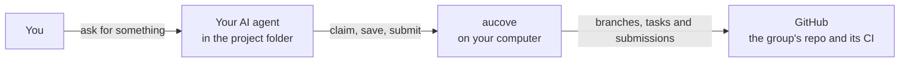
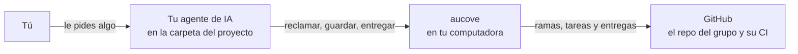

<p align="center">
  
</p>

<h1 align="center">aucove</h1>

<p align="center">
  <b>Verifiable collaborative authorship</b> for research teams that work with AI.<br>
  <i>Autoría colaborativa verificable para equipos de investigación que trabajan con IA.</i>
</p>

<p align="center">
  <a href="https://pypi.org/project/aucove/"></a>
  <a href="https://github.com/aucove/aucove/actions/workflows/ci.yml"></a>
  
  <a href="LICENSE"></a>
  <a href="spec/"></a>
</p>

<p align="center"><a href="#english">English</a> · <a href="#español">Español</a></p>

## English

### Why aucove

AI models and agents are changing the way research is done. In many groups, each person already works with an assistant that searches the literature, discusses ideas, drafts text and runs analyses, and several people do so at the same time on the same project. aucove is a proposal for bringing AI models into collaborative research the way it already happens: each person works with their own agent on a shared repository, and the group keeps clear rules about who does what, who reviews it and what goes into the shared version.

When AI writes part of the text or the code, authorship has to come first. It matters who proposed an idea, who did the work, who reviewed it and when, and the group must be able to show it without relying on memory or goodwill. aucove gathers that evidence while the work happens:

- each submission and each merge is sealed with a verifiable timestamp;
- with the project signature, a key that the group publishes proves that each record comes from the project;
- the project history is versioned, in a private repository that opens at milestones or in a public one from day one;
- every save declares which AI tool and model were used;
- at each milestone, the group safeguards the evidence outside GitHub, for example as an encrypted registration on OSF, and can publish the work with a DOI on Zenodo.

With that record, authorship conflicts can be prevented, or settled with evidence.

aucove grew out of that need. It is open source, anyone who wants to collaborate is welcome, and we hope it is useful in your projects.

### What it is

*aucove* is an open source framework for research teams that work in parallel on a shared GitHub repository, each person with the AI agent of their choice, such as Antigravity CLI, Claude Code, Codex, Cursor, Gemini CLI, GitHub Copilot, goose or OpenCode. Each person is in charge of parts of the work and takes tasks without clashing with others, and someone else reviews and approves each submission. CI validates every submission, builds the PDF when the project uses LaTeX and seals it with a verifiable timestamp, so everyone can prove their contribution without publishing early.

The name comes from the Spanish **AU**toría **CO**laborativa **VE**rificable (verifiable collaborative authorship), and it is pronounced *AW-kove*.

### How it works

1. **Task.** A concrete piece of work on your parts, such as the methods, a chapter or an experiment. You claim it so nobody else takes it.
2. **Submission.** Your work ready for review, with a note on what you did. CI checks it and seals it.
3. **Approval.** Someone else reviews it and merges it into the shared version.



Your agent opens in the project folder, a clone of the group's repository, and calls aucove for the mechanical work. Whatever the agent runs, such as an analysis, a training run or the PDF build, runs on your computer. A cloud session, such as Claude Code on the web (claude.ai/code), is an option when you do not want to install anything. More in [How it works](docs/en/how-it-works.md).

### What sets it apart

- **Verifiable timestamps and origin.** Every submission is sealed with OpenTimestamps, and every merge also with two RFC 3161 timestamps. With the project signature, a key that the group publishes also proves that the project issued each record. The repository can stay private, and anyone can verify a seal later, even without aucove.
- **Parts with owners.** Each part has a person in charge. The agent does not touch other people's parts, and if something slips through, CI stops it before it reaches the shared version.
- **AI as a declared assistant.** The agent searches the literature, discusses ideas, writes and runs code. Every save records the tool and the model used, and approving is still up to people.
- **With the agent of your choice, or none.** Every agent follows the same rules (`AGENTS.md`) and goes through the same CI. Claude Code and Codex get the full integration from `0.1.0` (skills, MCP server and hooks). Any other agent that reads `AGENTS.md` and can run commands, such as Antigravity CLI, Cursor, Gemini CLI, GitHub Copilot, goose or OpenCode, works with the rules, the shared context and the CLI, and CI stops its mistakes. You can also work without AI, with the CLI.
- **Data stays where it belongs.** Raw data never enters the repository, and the lead sets what the AI may see depending on how sensitive the data is.
- **LaTeX is optional.** With LaTeX, CI builds the PDF of every submission; without it, the project works in Markdown.

### Installation

Install it once per computer, in two steps: first [uv](https://docs.astral.sh/uv/), the tool that installs it, and then aucove itself, in its exact version and with the dependencies pinned in the `requirements-lock.txt` of its Release (01-arquitectura §5.1).

**1. uv.** Skip this step if `uv --version` already works in your terminal.

On Windows, in PowerShell 5.1 or 7:

```powershell
powershell -ExecutionPolicy ByPass -c "irm https://astral.sh/uv/install.ps1 | iex"
```

On macOS or Linux, in bash or zsh:

```bash
curl -LsSf https://astral.sh/uv/install.sh | sh
```

If your institution blocks these scripts, use `winget install --id=astral-sh.uv -e` on Windows or `brew install uv` on macOS. **Then close the terminal and open a new one**, so that it finds the `uv` command.

**2. aucove**, in the new terminal.

On Windows, in PowerShell:

```powershell
$lock = New-TemporaryFile
Invoke-WebRequest -UseBasicParsing https://github.com/aucove/aucove/releases/download/v0.1.0rc3/requirements-lock.txt -OutFile $lock.FullName
$env:UV_COMPILE_BYTECODE = "1"; uv tool install "aucove==0.1.0rc3" --constraints $lock.FullName
uv tool update-shell
```

On macOS or Linux, in bash or zsh:

```bash
LOCK="$(mktemp)"
curl -fsSL -o "$LOCK" https://github.com/aucove/aucove/releases/download/v0.1.0rc3/requirements-lock.txt
UV_COMPILE_BYTECODE=1 uv tool install "aucove==0.1.0rc3" --constraints "$LOCK"
uv tool update-shell
```

Then restart the terminal and your agent. `aucove doctor` checks the installation, the GitHub token and the project, and says what to fix.

To verify evidence seals on your computer (`aucove evidence verify`), install it with the `evidence` extra: in the `uv tool install` command, write `"aucove[evidence]==0.1.0rc3"`. If aucove is already installed, the same command adds the extra. CI seals every submission without it.

### Getting started

To start a project, the lead creates an empty repository on GitHub (without a README) and, in an empty folder on their computer, runs once:

```bash
aucove init --repo <organization>/<repo>
```

`init` writes the template there, asks for the language and the licenses, has you confirm and paste a one-day administration token, and pushes the project to GitHub with its protections. Then you open your agent in that folder. There are two ways to do it:

- **From the terminal:** run `init` in PowerShell or Terminal, then open your agent in the folder.
- **With the agent from the start, in a single folder:** open the agent in the empty folder and let it guide you, but run `init` yourself in a separate terminal, because it asks for confirmations and the token, which must not go through the AI. When it finishes, restart the agent in the same folder so it loads the project's tools and your token.

The [user guide](docs/en/README.md) is organized by role ([en español](docs/es/README.md)):

- **Researcher:** [setting up your computer and token, and a day of work with the agent](docs/en/researcher.md).
- **Lead:** [setting up the project once and reviewing submissions every week](docs/en/lead.md).
- **When a stage closes:** [safeguarding the evidence and publishing](docs/en/publish-and-safeguard.md).
- **Whoever administers the repo:** [the project signature, set up once](docs/en/project-signature.md).
- **Whoever reviews from outside:** [verifying a record or a package](docs/en/verify.md).
- **When something happens:** [clashes, expired tasks, data, tokens and failures](docs/en/when-something-happens.md).
- **To see how projects are set up:** [four example teams](docs/en/examples.md).

### Status

Version 0.1. `0.1.0rc3` is a preliminary release with the complete core (CLI and MCP server), the template, its CI, the project signature and `init --repo`, which creates a project from an empty folder. The skills and hooks for Claude Code and Codex, such as `/start` and `/submit`, the published template repository and the devcontainer arrive with `0.1.0`. In the meantime, you ask the agent in your own words or use the `aucove` commands. The changes in each version are in [CHANGELOG.md](CHANGELOG.md), and the v0.1 specification, which is the normative authority, is in [`spec/`](spec/).

### Get involved

aucove is in its first version, and we want to improve it together with the people who use it. Every contribution helps:

- **Tell us how it goes.** If you try it in your group, open an Issue with what worked, what was hard and what was missing.
- **Report bugs and suggest improvements** in the [Issues](https://github.com/aucove/aucove/issues).
- **Send changes** as a pull request. Read [CONTRIBUTING.md](CONTRIBUTING.md) first: every commit carries `Signed-off-by` (DCO), and AI assistance is declared with `Assisted-by`.
- **Help with the documentation**: improve the guides, or translate them into other languages.
- **Weigh in on the design.** The open questions of the specification are in [`spec/13-preguntas-abiertas.md`](spec/13-preguntas-abiertas.md), in Spanish.

aucove itself is developed with the help of AI agents. Commits made with AI declare it with `Assisted-by` (the tool and the model), and the person who signs them with `Signed-off-by` reviewed the change and takes responsibility for it. The AI is not listed as a co-author, because it cannot be an author or answer for the code.

To report a vulnerability, follow [SECURITY.md](SECURITY.md) instead of opening an Issue. Participation is governed by [CODE_OF_CONDUCT.md](CODE_OF_CONDUCT.md).

### Verifying a release

Every version is published from this repository with Trusted Publishing and carries attestations of its build (10-seguridad §6). To check that a wheel came from this repository's release workflow:

```bash
pypi-attestations verify pypi --repository https://github.com/aucove/aucove pypi:aucove-0.1.0rc3-py3-none-any.whl
gh attestation verify aucove-0.1.0rc3-py3-none-any.whl -R aucove/aucove
```

The first command uses [pypi-attestations](https://pypi.org/project/pypi-attestations/), installed separately, and the second the GitHub CLI on the downloaded wheel.

<details>
<summary><b>Supported gates</b></summary>

| Gate | Surface | Level |
|---|---|---|
| Claude Code | Terminal, IDE extensions and the Code tab of Claude Desktop | 1 |
| Claude Code | Web sessions (claude.ai/code); releasing a task is done from the terminal or Desktop | 1 |
| Agents that read `AGENTS.md` | Codex and Antigravity CLI, without a hooks guarantee | 2 |
| Agents that read `AGENTS.md` | OpenCode and goose, without a smoke test | 2 |
| GitHub web | Review and merging | 1 |
| Environment | `.devcontainer/` and Codespaces | 2 |

Level 1 is tested on every change or every release, and a defect blocks publication. Level 2 has a manual smoke test on every release, and a defect is documented in its notes. Other gates (the Chat tab of Claude Desktop, Cowork, claude.ai, Overleaf, Jupyter AI…) are not supported in v0.1 (12-mvp §1.3). Any other agent that reads `AGENTS.md` and can run commands, such as Cursor, Gemini CLI or GitHub Copilot, works at the basic level: the rules, the shared context and the CLI, without hooks, and CI stops its mistakes (00-marco D-58).

</details>

<details>
<summary><b>Repository layout</b></summary>

| Path | Contents |
|---|---|
| `src/aucove/` | Core package |
| `spec/` | v0.1 specification, the normative authority |
| `docs/` | User guide, in English and Spanish |
| `schemas/` | Published JSON schemas (verified copy of `spec/schemas/`) |
| `template/` | Single source of the template repository (`base/`, `l10n/es`, `l10n/en` and the `formats/` variants) |
| `skills/` | Single source of the skills |
| `tools/` | Build and release scripts (in the sdist, not in the wheel) |
| `tests/` | Tests |
| `deploy/` | Reserved for the full mode; no code in v0.1 |

</details>

### Licenses

The framework is released under Apache-2.0 (`LICENSE` and `NOTICE`). Each path has its license in `REUSE.toml`, and the repository complies with REUSE 3.3 (`reuse lint`).

| Path | License |
|---|---|
| `src/`, `tools/`, `tests/`, `schemas/` and the rest of the repository | Apache-2.0 |
| `spec/` and `docs/` | CC-BY-4.0 |
| `skills/` | MIT-0 |
| `template/` | MIT-0 for code and CC0-1.0 for example text; `template/base/` has its own `REUSE.toml` |
| `src/aucove/_data/spdx-licenses.json` | CC0-1.0 (the SPDX license list) |

The template and the skills use licenses without conditions so that research projects do not inherit Apache-2.0 obligations (11-trazabilidad REQ-TRACE-57).

### Non-affiliation notice

> *aucove* is an independent open source project. It is not affiliated with, endorsed by, or sponsored by Anthropic, OpenAI, Google, GitHub, or any other provider mentioned. Claude, Claude Code, Codex, Gemini, GitHub, and other marks belong to their respective owners and are mentioned only to indicate compatibility.

## Español

### Por qué aucove

El uso de modelos y agentes de IA está cambiando la forma de hacer investigación. En muchos grupos, cada persona ya trabaja con un asistente que busca bibliografía, discute ideas, redacta y corre análisis, y varias lo hacen a la vez en un mismo proyecto. aucove es una propuesta para integrar los modelos de IA a la investigación colaborativa tal como ya sucede: cada quien trabaja con su agente sobre un repositorio común, y el grupo mantiene reglas claras sobre quién hace qué, quién lo revisa y qué entra a la versión común.

Cuando la IA escribe parte del texto o del código, la autoría tiene que ser lo primero. Importa quién propuso una idea, quién hizo el trabajo, quién lo revisó y cuándo, y el grupo tiene que poder mostrarlo sin depender de la memoria ni de la buena voluntad. aucove reúne esa evidencia mientras se trabaja:

- cada entrega y cada integración se sellan con una fecha verificable;
- con la firma del proyecto, una llave que publica el grupo prueba que cada registro viene del proyecto;
- la historia del proyecto queda versionada, en un repositorio privado que se abre por hitos o en uno público desde el primer día;
- cada guardado declara qué herramienta y qué modelo de IA se usaron;
- en cada hito, el grupo resguarda las pruebas fuera de GitHub, por ejemplo en un registro cifrado de OSF, y puede publicar el trabajo con un DOI en Zenodo.

Con ese registro, los conflictos de autoría se pueden prevenir o resolver con pruebas.

aucove surge de esa necesidad. Es de código abierto, quien quiera colaborar es bienvenido, y esperamos que les sea útil en sus proyectos.

### Qué es

*aucove* es un framework de código abierto para equipos de investigación que trabajan en paralelo sobre un mismo repositorio de GitHub, cada persona con el agente de IA que prefiera, como Antigravity CLI, Claude Code, Codex, Cursor, Gemini CLI, GitHub Copilot, goose u OpenCode. Cada quien tiene a su cargo partes del trabajo y toma tareas sin chocar con las demás, y otra persona revisa y aprueba cada entrega. El CI valida cada entrega, compila el PDF si el proyecto usa LaTeX y la sella con una fecha verificable: cada quien puede probar su aporte sin publicar antes de tiempo.

El nombre viene de **AU**toría **CO**laborativa **VE**rificable, y se pronuncia *au-CO-ve*.

### Cómo funciona

1. **Tarea.** Un trabajo concreto sobre tus partes, como los métodos, un capítulo o un experimento. La reclamas para que nadie más la tome.
2. **Entrega.** Tu trabajo listo para revisión, con una nota de lo que hiciste. El CI la revisa y la sella.
3. **Aprobación.** Otra persona la revisa y la integra a la versión común.



Tu agente se abre en la carpeta del proyecto, que es un clon del repo del grupo, y llama a aucove para el trabajo mecánico. Lo que el agente ejecuta, como un análisis, un entrenamiento o la compilación del PDF, corre en tu computadora. Una sesión en la nube, como la web de Claude Code (claude.ai/code), es una opción para cuando no quieres instalar nada. Lo explica [Cómo funciona](docs/es/como-funciona.md).

### Qué lo distingue

- **Fecha y origen verificables.** Cada entrega se sella con OpenTimestamps, y cada integración, además, con dos sellos de tiempo RFC 3161. Con la firma del proyecto, una llave que publica el grupo prueba además que el proyecto emitió cada registro. El repo puede seguir privado, y cualquiera puede verificar un sello después, incluso sin aucove.
- **Partes con dueño.** Cada parte tiene una persona a cargo. El agente no toca lo ajeno, y si algo se cuela, el CI lo detiene antes de que llegue a la versión común.
- **La IA como asistente, y declarada.** El agente busca bibliografía, discute ideas, escribe y corre código. Cada guardado registra la herramienta y el modelo que se usaron, y aprobar sigue siendo cosa de personas.
- **Con el agente que prefieras, o sin ninguno.** Todos siguen las mismas reglas (`AGENTS.md`) y pasan por el mismo CI. Claude Code y Codex tienen la integración completa desde la `0.1.0` (skills, servidor MCP y hooks). Cualquier otro agente que lea `AGENTS.md` y pueda ejecutar comandos, como Antigravity CLI, Cursor, Gemini CLI, GitHub Copilot, goose u OpenCode, trabaja con las reglas, el contexto compartido y la CLI, y el CI detiene sus errores. También se puede trabajar sin IA, con la CLI.
- **Los datos en su lugar.** Los datos crudos nunca entran al repo, y el responsable fija qué puede ver la IA según qué tan sensibles son.
- **LaTeX opcional.** Con LaTeX, el CI compila el PDF de cada entrega; sin LaTeX, el proyecto trabaja en Markdown.

### Instalación

aucove se instala una vez por computadora, en dos pasos: primero [uv](https://docs.astral.sh/uv/), la herramienta que lo instala, y después aucove, en su versión exacta y con las dependencias fijadas en el `requirements-lock.txt` de su Release (01-arquitectura §5.1).

**1. uv.** Sáltate este paso si `uv --version` ya funciona en tu terminal.

En Windows, en PowerShell 5.1 o 7:

```powershell
powershell -ExecutionPolicy ByPass -c "irm https://astral.sh/uv/install.ps1 | iex"
```

En macOS o Linux, en bash o zsh:

```bash
curl -LsSf https://astral.sh/uv/install.sh | sh
```

Si tu institución bloquea esos scripts, usa `winget install --id=astral-sh.uv -e` en Windows o `brew install uv` en macOS. **Después cierra la terminal y abre una nueva**, para que encuentre el comando `uv`.

**2. aucove**, en la terminal nueva.

En Windows, en PowerShell:

```powershell
$lock = New-TemporaryFile
Invoke-WebRequest -UseBasicParsing https://github.com/aucove/aucove/releases/download/v0.1.0rc3/requirements-lock.txt -OutFile $lock.FullName
$env:UV_COMPILE_BYTECODE = "1"; uv tool install "aucove==0.1.0rc3" --constraints $lock.FullName
uv tool update-shell
```

En macOS o Linux, en bash o zsh:

```bash
LOCK="$(mktemp)"
curl -fsSL -o "$LOCK" https://github.com/aucove/aucove/releases/download/v0.1.0rc3/requirements-lock.txt
UV_COMPILE_BYTECODE=1 uv tool install "aucove==0.1.0rc3" --constraints "$LOCK"
uv tool update-shell
```

Después, reinicia la terminal y tu agente. `aucove doctor` comprueba la instalación, el token de GitHub y el proyecto, y dice qué arreglar.

Para verificar sellos en tu computadora (`aucove evidence verify`), instálalo con el extra `evidence`: en el comando `uv tool install`, escribe `"aucove[evidence]==0.1.0rc3"`. Si aucove ya estaba instalado, el mismo comando le agrega el extra. El CI sella cada entrega sin él.

### Primeros pasos

Para empezar un proyecto, el responsable crea en GitHub un repo vacío (sin README) y, en una carpeta vacía de su computadora, corre una sola vez:

```bash
aucove init --repo <organización>/<repo>
```

`init` arma ahí la plantilla, pregunta el idioma y las licencias, pide confirmar y pegar un token de administración de un día, y sube el proyecto a GitHub con sus protecciones. Después abres el agente en esa carpeta. Hay dos caminos:

- **Por terminal:** corres `init` en PowerShell o en Terminal y luego abres el agente en la carpeta.
- **Con el agente desde el principio, en una sola carpeta:** abres el agente en la carpeta vacía y te acompaña, pero `init` lo corres tú en una terminal aparte, porque pide confirmaciones y el token, que no deben pasar por la IA. Al terminar, reinicias el agente en la misma carpeta para que cargue las herramientas del proyecto y tu token.

La [guía de uso](docs/es/README.md) va por perfil ([in English](docs/en/README.md)):

- **Investigador:** [preparar tu computadora y tu token, y un día de trabajo con el agente](docs/es/investigador.md).
- **Responsable:** [preparar el proyecto una vez y revisar las entregas cada semana](docs/es/responsable.md).
- **Al cerrar una etapa:** [resguardar las pruebas y publicar](docs/es/publicar-y-resguardar.md).
- **Quien administra el repo:** [la firma del proyecto, una sola vez](docs/es/firma-del-proyecto.md).
- **Quien revisa desde afuera:** [verificar un registro o un paquete](docs/es/verificar.md).
- **Si pasa algo:** [choques, vencimientos, datos, tokens y fallas](docs/es/cuando-pasa.md).
- **Para ver cómo se configura cada proyecto:** [cuatro equipos de ejemplo](docs/es/ejemplos.md).

### Estado

Versión 0.1. La `0.1.0rc3` es una versión preliminar con el núcleo completo (CLI y servidor MCP), la plantilla, su CI, la firma del proyecto e `init --repo`, que crea un proyecto desde una carpeta vacía. Los skills y los hooks para Claude Code y Codex, como `/empezar` y `/entregar`, el repositorio plantilla publicado y el devcontainer llegan con la `0.1.0`. Mientras tanto, lo mismo se le pide al agente con palabras o se hace con los comandos `aucove`. Los cambios de cada versión están en [CHANGELOG.md](CHANGELOG.md), y la especificación v0.1, que es la autoridad normativa, en [`spec/`](spec/).

### Colabora

aucove está en su primera versión y queremos mejorarlo junto con quienes lo usan. Cualquier aporte ayuda:

- **Cuéntanos cómo te va.** Si lo pruebas en tu grupo, abre un Issue con lo que funcionó, lo que costó y lo que faltó.
- **Reporta errores y propón mejoras** en los [Issues](https://github.com/aucove/aucove/issues).
- **Envía cambios** con un pull request. Lee antes [CONTRIBUTING.md](CONTRIBUTING.md): todo commit lleva `Signed-off-by` (DCO) y la ayuda de una IA se declara con `Assisted-by`.
- **Ayuda con la documentación**: mejora las guías o tradúcelas a otros idiomas.
- **Opina sobre el diseño.** Las preguntas abiertas de la especificación están en [`spec/13-preguntas-abiertas.md`](spec/13-preguntas-abiertas.md).

aucove mismo se desarrolla con ayuda de agentes de IA. Los commits hechos con IA lo declaran con `Assisted-by` (la herramienta y el modelo), y la persona que los firma con `Signed-off-by` revisó el cambio y responde por él. La IA no figura como coautora, porque no puede ser autora ni responder por el código.

Para reportar una vulnerabilidad, sigue [SECURITY.md](SECURITY.md) en lugar de abrir un Issue. La convivencia se rige por [CODE_OF_CONDUCT.md](CODE_OF_CONDUCT.md).

### Verificar una versión

Cada versión se publica desde este repositorio con Trusted Publishing y lleva atestaciones de su construcción (10-seguridad §6). Para comprobar que una rueda salió del workflow de release de este repositorio:

```bash
pypi-attestations verify pypi --repository https://github.com/aucove/aucove pypi:aucove-0.1.0rc3-py3-none-any.whl
gh attestation verify aucove-0.1.0rc3-py3-none-any.whl -R aucove/aucove
```

El primer comando usa [pypi-attestations](https://pypi.org/project/pypi-attestations/), que se instala aparte, y el segundo, la CLI de GitHub sobre la rueda descargada.

<details>
<summary><b>Puertas soportadas</b></summary>

| Puerta | Superficie | Nivel |
|---|---|---|
| Claude Code | Terminal, extensiones de IDE y pestaña Code de Claude Desktop | 1 |
| Claude Code | Sesiones web (claude.ai/code); soltar una tarea se hace desde la terminal o Desktop | 1 |
| Agentes que leen `AGENTS.md` | Codex y Antigravity CLI, sin garantía de hooks | 2 |
| Agentes que leen `AGENTS.md` | OpenCode y goose, sin prueba de humo | 2 |
| Web de GitHub | Revisión e integración | 1 |
| Entorno | `.devcontainer/` y Codespaces | 2 |

El nivel 1 se prueba en cada cambio o en cada versión, y un defecto bloquea la publicación. El nivel 2 tiene una prueba de humo manual en cada versión, y un defecto se documenta en sus notas. Las demás puertas (la pestaña Chat de Claude Desktop, Cowork, claude.ai, Overleaf, Jupyter AI…) no están soportadas en v0.1 (12-mvp §1.3). Cualquier otro agente que lea `AGENTS.md` y pueda ejecutar comandos, como Cursor, Gemini CLI o GitHub Copilot, trabaja en el nivel básico: las reglas, el contexto compartido y la CLI, sin hooks, y el CI detiene sus errores (00-marco D-58).

</details>

<details>
<summary><b>Estructura del repositorio</b></summary>

| Ruta | Contenido |
|---|---|
| `src/aucove/` | Paquete del núcleo |
| `spec/` | Especificación v0.1, autoridad normativa |
| `docs/` | Guía de uso, en inglés y en español |
| `schemas/` | Esquemas JSON publicados (copia verificada de `spec/schemas/`) |
| `template/` | Fuente única del repositorio plantilla (`base/`, `l10n/es`, `l10n/en` y las variantes de `formats/`) |
| `skills/` | Fuente única de los skills |
| `tools/` | Scripts de build y release (van en el sdist, no en la rueda) |
| `tests/` | Pruebas |
| `deploy/` | Reservado para el modo completo; sin código en v0.1 |

</details>

### Licencias

El framework se publica bajo Apache-2.0 (`LICENSE` y `NOTICE`). Cada ruta tiene su licencia en `REUSE.toml`, y el repositorio cumple REUSE 3.3 (`reuse lint`).

| Ruta | Licencia |
|---|---|
| `src/`, `tools/`, `tests/`, `schemas/` y el resto del repositorio | Apache-2.0 |
| `spec/` y `docs/` | CC-BY-4.0 |
| `skills/` | MIT-0 |
| `template/` | MIT-0 para el código y CC0-1.0 para el texto de ejemplo; `template/base/` trae su propio `REUSE.toml` |
| `src/aucove/_data/spdx-licenses.json` | CC0-1.0 (la lista de licencias de SPDX) |

La plantilla y los skills van en licencias sin condiciones para que los proyectos de investigación no hereden obligaciones de Apache-2.0 (11-trazabilidad REQ-TRACE-57).

### Aviso de no afiliación

> *aucove* es un proyecto independiente de código abierto. No está afiliado a Anthropic, OpenAI, Google, GitHub ni a otros proveedores mencionados, ni cuenta con su respaldo o patrocinio. Claude, Claude Code, Codex, Gemini, GitHub y las demás marcas pertenecen a sus titulares y se mencionan solo para indicar compatibilidad.
