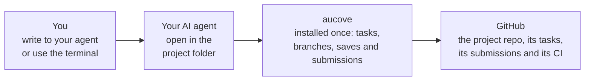

# How it works

[User guide](README.md) › How it works

Each person is in charge of parts of the work, such as the methods, the results or a chapter, and works on them with the AI agent of their choice, such as Antigravity CLI, Claude Code, Codex, Cursor, Gemini CLI, GitHub Copilot, goose or OpenCode. Everything lives in a GitHub repository of the group.

1. **Task.** A concrete piece of work on your parts. You claim it so nobody else takes it.
2. **Submission.** Your work ready for review, with a note on what you did. It is sealed with a verifiable timestamp.
3. **Approval.** Someone else reviews it and merges it into the shared version.

GitHub's automatic checks (CI) review every submission and, if the project uses LaTeX, build the PDF. If the agent touches something it should not, CI stops it before it reaches the shared version. The seal proves that a text or a result existed on a given date, even if the repository stays private: everyone can defend their contribution without publishing early.

## How the pieces fit together

There are two different things on your computer. One is aucove, which you install once, like any other program. The other is the project folder: a copy (a clone) of the group's repository on GitHub. Your agent opens inside that folder.



- **aucove is not cloned or opened.** It is a command-line program that your agent and you use when it is time to claim, save or submit.
- **The project folder carries the connection.** `AGENTS.md` has the rules for any agent (and `CLAUDE.md`, the same rules for Claude Code), and `.mcp.json` tells Claude Code how to start aucove. From 0.1.0 on, it also brings the shortcuts and hooks for Claude Code and Codex; with other agents, you ask for the same thing in words.
- **Your agent opens there.** With its command in a terminal inside the folder (for example `claude`, `codex`, `copilot` or `gemini`), or by choosing the folder in your editor or in Claude Desktop. When it starts, it reads the project's rules and context, and it calls aucove when needed. aucove talks to GitHub with your token.
- **The web is an option, not the required path.** On claude.ai/code all of this happens on a cloud machine, without installing anything or creating a token. The difference is in the next section.

```text
ising-diluido/          the project folder: a clone of the GitHub repo
├── AGENTS.md           rules for any agent
├── CLAUDE.md           the same rules, for Claude Code
├── .mcp.json           tells Claude Code how to start aucove
├── plan.md             goal, questions, hypotheses and methods
├── roles.yaml          people, roles and the owner of each part
├── project.yaml        the project configuration
├── memory/             constitution, decisions and session notes
├── data/README.md      where the raw data lives
└── sections/<part>/    each person's work
```

## Where the code runs

When you ask the agent to run an analysis, train a model or build the PDF, that code **runs on your computer**, with your Python, your files and your GPU. The AI model thinks on its provider's servers, but whatever it runs, runs where you opened the session. Your computer is the usual place; the web is an option for when you do not want to install anything.

| | On your computer | In the browser |
|---|---|---|
| **With what** | Your agent in the terminal, in your editor or in Claude Desktop | A cloud session, such as claude.ai/code |
| **Where your script runs** | On your machine, with your Python, your CPU and your GPU | On an Anthropic virtual machine, new for each session: about 4 cores and 16 GB of RAM, no GPU |
| **Which files it sees** | Those on your computer, with your permissions. The agent asks for permission before running anything, depending on how you configure it | Only what is already in the GitHub repo |
| **Data outside the repo** | Yes, if your machine can reach it, such as the NAS or the cluster | No |
| **Limits** | Those of your machine | Commands of a few minutes; the machine pauses if you leave it idle |
| **Your work** | Stays in your folder, and aucove pushes it to GitHub when you save and submit | Lives on that machine until aucove pushes it when you save or submit: save often |

**Either way, what the agent reads travels to the model:** the content of the files it opens and the output of the commands it runs. If your script prints rows with personal data, those rows reach the provider. With sensitive data, you run the script yourself and show the agent only aggregated results. What the AI may see is in [When something happens › Data and people](when-something-happens.md#data-and-people).

- **Real, large or GPU-heavy data:** on your computer or on the cluster. The code and the results of your part go to the repo, never the raw data.
- **The web:** for writing, reviewing or running code with the small data that lives in the repo, from any computer.
- **You can switch between them:** in Claude Desktop, «Open in › Cloud» sends a session to the cloud, and `claude --teleport` brings a web session to your computer.

The same applies to other agents: their terminal version runs on your computer, and their cloud version, if they have one, on their provider's servers. Claude Code on the web comes with the Pro, Max and Team plans, and with Enterprise on a seat that includes Claude Code; Free does not include it. With a zero data retention (ZDR) contract there are no cloud sessions: you work on your computer.

## What you type

| In the agent's chat | What happens |
|---|---|
| `/start` | You pick a task and the agent catches up with the plan. |
| `/submit` | The agent summarizes the session and opens the submission for review. |

Everything else you ask the agent in your own words: search, summarize, propose ideas, write code, run this. The full list is in [Researcher › What you type or say](researcher.md#what-you-type-or-say).
