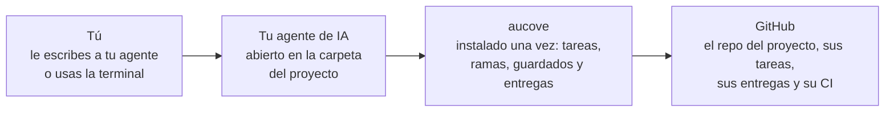

# Cómo funciona

[Guía de uso](README.md) › Cómo funciona

Cada persona tiene a su cargo partes del trabajo, como los métodos, los resultados o un capítulo, y trabaja en ellas con el agente de IA que prefiera, como Antigravity CLI, Claude Code, Codex, Cursor, Gemini CLI, GitHub Copilot, goose u OpenCode. Todo vive en un repositorio de GitHub del grupo.

1. **Tarea.** Un trabajo concreto sobre tus partes. La reclamas para que nadie más la tome.
2. **Entrega.** Tu trabajo listo para revisión, con una nota de lo que hiciste. Queda sellado con una fecha verificable.
3. **Aprobación.** Otra persona lo revisa y lo integra a la versión común.

Los checks automáticos de GitHub (el CI) revisan cada entrega y, si el proyecto usa LaTeX, compilan el PDF. Si el agente toca algo que no debía, el CI lo detiene antes de que llegue a la versión común. El sello prueba que un texto o un resultado existía en una fecha, aunque el repositorio siga privado: cada quien puede defender su aporte sin publicar antes de tiempo. Con la [firma del proyecto](firma-del-proyecto.md), una llave que publica el grupo prueba además que el registro lo emitió el proyecto.

## Cómo se conectan las piezas

En tu computadora hay dos cosas distintas. Una es aucove, que se instala una sola vez, como cualquier programa. La otra es la carpeta del proyecto: una copia (un clon) del repositorio del grupo en GitHub. Tu agente se abre dentro de esa carpeta.



- **aucove no se clona ni se abre.** Es un programa de línea de comandos que usan tu agente y tú cuando hay que reclamar, guardar o entregar.
- **La carpeta del proyecto trae la conexión.** `AGENTS.md` tiene las reglas para cualquier agente (y `CLAUDE.md`, las mismas para Claude Code), y `.mcp.json` le dice a Claude Code cómo arrancar aucove. Desde la 0.1.0 también trae los atajos y los hooks para Claude Code y Codex; con los demás agentes, lo mismo se pide con palabras.
- **Tu agente se abre ahí.** Con su comando en una terminal dentro de la carpeta (por ejemplo `claude`, `codex`, `copilot` o `gemini`), o eligiendo la carpeta en tu editor o en Claude Desktop. Al empezar lee las reglas y el contexto del proyecto, y llama a aucove cuando hace falta. aucove habla con GitHub con tu token.
- **La web es una opción, no el camino obligado.** En claude.ai/code todo eso pasa en una máquina de la nube, sin instalar nada ni crear token. La diferencia está en la sección siguiente.

```text
ising-diluido/          la carpeta del proyecto: un clon del repo de GitHub
├── AGENTS.md           reglas para cualquier agente
├── CLAUDE.md           las mismas reglas, para Claude Code
├── .mcp.json           le dice a Claude Code cómo arrancar aucove
├── plan.md             objetivo, preguntas, hipótesis y métodos
├── roles.yaml          personas, roles y dueño de cada parte
├── project.yaml        la configuración del proyecto
├── memory/             constitución, decisiones y notas de sesión
├── data/README.md      dónde viven los datos crudos
└── sections/<parte>/   el trabajo de cada persona
```

## Dónde corre el código

Cuando le pides al agente que corra un análisis, entrene un modelo o compile el PDF, ese código **se ejecuta en tu computadora**, con tu Python, tus archivos y tu GPU. El modelo de IA piensa en los servidores de su proveedor, pero lo que ejecuta corre donde abriste la sesión. Lo habitual es tu computadora; la web es una opción para cuando no quieres instalar nada.

| | En tu computadora | En el navegador |
|---|---|---|
| **Con qué** | Tu agente en la terminal, en tu editor o en Claude Desktop | Una sesión en la nube, como claude.ai/code |
| **Dónde corre tu script** | En tu máquina, con tu Python, tu CPU y tu GPU | En una máquina virtual de Anthropic, nueva en cada sesión: unos 4 núcleos y 16 GB de RAM, sin GPU |
| **Qué archivos ve** | Los de tu computadora, con tus permisos. El agente te pide permiso antes de ejecutar, según cómo lo configures | Solo lo que ya está en el repo de GitHub |
| **Datos fuera del repo** | Sí, si tu máquina llega a ellos, como el NAS o el clúster | No |
| **Límites** | Los de tu máquina | Comandos de pocos minutos; la máquina se pausa si la dejas sin usar |
| **Tu trabajo** | Queda en tu carpeta, y aucove lo sube a GitHub al guardar y al entregar | Vive en esa máquina hasta que aucove lo sube al guardar o al entregar: guarda seguido |

**En los dos casos, lo que el agente lee viaja al modelo:** el contenido de los archivos que abre y la salida de los comandos que corre. Si tu script imprime filas con datos de personas, esas filas llegan al proveedor. Con datos sensibles, el script lo corres tú y al agente le muestras solo resultados agregados. Lo que puede ver la IA está en [Cuando pasa › Datos y personas](cuando-pasa.md#datos-y-personas).

- **Datos reales, grandes o con GPU:** en tu computadora o en el clúster. Al repo suben el código y los resultados de tu parte, nunca los datos crudos.
- **La web:** para redactar, revisar o correr código con los datos chicos que viven en el repo, desde cualquier computadora.
- **Puedes pasar de una a otra:** en Claude Desktop, «Open in › Cloud» manda una sesión a la nube, y `claude --teleport` trae a tu computadora una sesión de la web.

Lo mismo vale para los demás agentes: su versión de terminal corre en tu computadora, y su versión en la nube, si la tiene, en los servidores de su proveedor. Claude Code en la web viene en los planes Pro, Max y Team, y en Enterprise con un asiento que incluya Claude Code; Free no lo trae. Con un contrato sin retención de datos (ZDR) no hay sesiones en la nube: se trabaja en la computadora.

## Lo que escribes

| En el chat del agente | Qué pasa |
|---|---|
| `/empezar` | Eliges una tarea y el agente se pone al día con el plan. |
| `/entregar` | El agente resume la sesión y abre la entrega para revisión. |

Todo lo demás se lo pides al agente con tus palabras: busca, resume, propón ideas, programa, corre esto. La lista completa está en [Investigador › Lo que escribes o dices](investigador.md#lo-que-escribes-o-dices).
